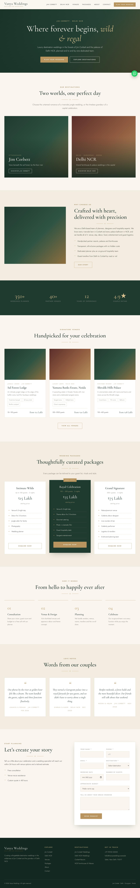

# Vanya Weddings — Destination weddings in Jim Corbett & Delhi NCR

A full-stack wedding website: **Next.js 16** frontend, **Node.js / Express** API, **SQLite** database
(Node's built-in `node:sqlite`, no native modules to compile).



## Pages

| Route | What it does |
| --- | --- |
| `/` | Hero, two destinations, why us, stats, signature venues, packages, process, testimonials, enquiry form |
| `/destinations/jim-corbett` · `/destinations/delhi-ncr` | Destination story, highlights, season and distance facts, signature experiences, venues, testimonials, prefilled enquiry form |
| `/venues` (`?destination=`) | All venues with destination filter |
| `/venues/[slug]` | Venue details plus an enquiry form tagged with the venue |
| `/packages` | Three packages; the CTA carries the package into the contact form |
| `/about`, `/contact` | About page; contact details and form |
| `/admin/login`, `/admin` | Admin dashboard: view, filter and paginate enquiries, change status, delete |

## Run locally

```bash
npm run install:all
ADMIN_EMAIL=you@example.com ADMIN_PASSWORD='a-long-password' npm run dev:backend   # API on :4000
npm run dev:frontend                                                                # site on :3000
```

On first start the backend creates `backend/data/weddings.db` and seeds destinations, venues, packages and
testimonials.

**Customising**
- Brand name, phone, WhatsApp, email and address: `frontend/lib/site.js`.
- Colours and fonts: the CSS variables at the top of `frontend/app/globals.css`. Headings use Cormorant Garamond
  and body text uses Jost, both self-hosted via `@fontsource`.
- Venues, packages and copy: `backend/src/seed.js`. The venue names are placeholders; replace them with your
  real partners. Seeding is idempotent by slug.

## Tests

```bash
npm test            # API tests, production build, then Playwright browser tests
npm run test:api    # 34 API, security and rate-limit tests (node:test + supertest)
npm run test:e2e    # 27 Chromium tests (desktop and mobile) against real servers and a throwaway DB
```

The e2e suite covers every page and link, the header, footer, mobile menu and filters, enquiry submission and
validation, the full admin lifecycle (login, view, status change, delete, logout), and the browser-level
security checks listed below.

## Security

| Threat | Mitigation | Tested in |
| --- | --- | --- |
| SQL injection | Prepared statements only, and slugs and ids validated by regex or schema | `security.test.js`, `security.spec.js` |
| Stored and reflected XSS | React escaping, strict nonce-based CSP (`strict-dynamic`, no `unsafe-eval` in prod), image URLs allow-listed before going into CSS | browser tests inject payloads and an HTML-injection bug, and assert nothing executes |
| CSRF | `SameSite=Strict` cookie, JSON-only bodies (415 otherwise), Origin allow-list (403) | both suites |
| Broken auth | bcrypt (cost 12), HS256 JWT with pinned algorithm and issuer, 2 h expiry, HttpOnly cookie, `Secure` in prod; same error and timing for unknown emails | forged, tampered, expired, `alg=none` and wrong-issuer tokens are all rejected |
| Brute force and spam | Rate limits per IP (login 10/15 min, enquiries 5/h, global 300/15 min), per admin account (resists rotating IPs), and per email (3 enquiries/day); hidden honeypot field | `ratelimit.test.js` |
| IP spoofing | The site proxy forwards only the last `X-Forwarded-For` hop; nginx overwrites it with `$remote_addr` | `security.spec.js` |
| Mass assignment | Strict Zod schemas reject unknown keys such as `status` and `id` | both suites |
| DoS via payload | 10 KB JSON limit (16 KB at the proxy); free-text length caps; page size capped at 100 | `security.test.js` |
| Info leakage | No `X-Powered-By`, generic 500s, no stack traces, internal API URL never exposed; IPs stored only as HMAC hashes | both suites |
| Clickjacking | `frame-ancestors 'none'` and `X-Frame-Options: DENY` | `security.spec.js` |
| Transport and headers | HSTS (prod), nosniff, Referrer-Policy, Permissions-Policy, COOP | `security.spec.js` |

## Production

1. Set the variables in `backend/.env.example`. `JWT_SECRET` (32+ characters) is required when `NODE_ENV=production`.
2. `npm run build`, then run `npm --prefix backend start` and `npm --prefix frontend start` under pm2 or systemd.
3. Put nginx in front of Next.js only (see `deploy/nginx.conf`). Keep the API on `127.0.0.1`. The
   `X-Forwarded-For $remote_addr` line matters, because IP-based rate limiting depends on it.
4. Back up `backend/data/weddings.db`. It uses WAL mode, so use `sqlite3 .backup` or copy it while the API is stopped.
